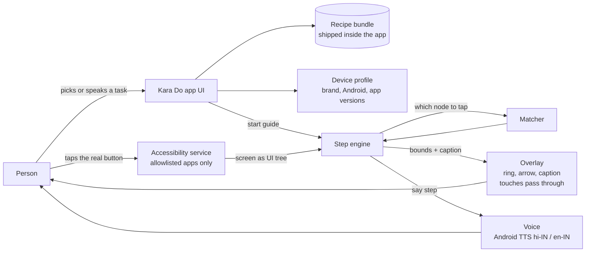

# Kara Do: system design v0.1 (draft for review)

Status: **Draft**, 2026-10-18. Mridul to critique. Builds on [ADR-0001 to 0004](../decisions/).

## 1. Goal of the MVP
Someone who isn't tech-savvy opens Kara Do, picks (or says) a task such as "brightness badhao", and gets guided **live, step by step, on their own phone**:
- a glowing ring around the exact button to tap,
- a large caption, and
- a Hindi or English voice.

They tap; Kara Do notices the screen changed and shows the next step. The MVP needs no AI, no account and no internet.

## 2. Big picture



Everything above runs on the phone. Layers 2 and 3 from ADR-0004 (an on-device model and opt-in cloud help) plug into the **Matcher** later, without changing the rest.

## 3. Components

### 3.1 App UI (Jetpack Compose)
- **Home:** big picture tiles of common tasks ("Gaana chalao", "Video call karo"), plus a mic button: "Aap kya karna chahte hain?"
- **First run (done with a trusted helper, see [ADR-0007](../decisions/0007-trusted-helper-setup.md)):**
  0. ask "Is someone you know and trust helping you right now?", and show the warning "Kara Do will never call you or ask you to install anything",
  1. choose a language,
  2. read a plain-language explanation of what the app can see and never does (the Play-required **prominent disclosure**),
  3. turn on the accessibility service, with a guided step-by-step flow for that too.
- **Elder-friendly basics:**
  - text 20sp or larger, high contrast, one action per screen;
  - "Repeat" and "Slower" buttons on every step (Stepli's testers asked for exactly these);
  - a big "Stop" button that is always visible.

### 3.1a How Kara Do talks (language style)
People should hear the words they actually use, not textbook Hindi. Use **everyday Hindi (Hinglish)**: Hindi words in Devanagari, but tech words people already know (Bluetooth, scroll, tap, Wi-Fi, Settings, button) stay **in English letters**, exactly as people see them on their phones:
- ✅ "नीचे scroll करिए", "Settings खोलिए", "Bluetooth connect करिए", "इस button पर tap करिए"
- ❌ "नीचे की ओर खिसकाइए", "समायोजन खोलें", "Bluetooth जोड़ें", "इस button को दबाएँ"

Rules:
1. Keep app and button names exactly as they appear on the screen ("Brightness", "Search"), because that's what the person has to find.
2. Use the polite *-इए* form ("करिए", "खोलिए"), one action per sentence, and short sentences.
3. Check that the Hindi voice (hi-IN TTS) pronounces the English words naturally inside Hindi sentences. That has to be tested on real phones.
4. Have a native speaker from the target audience review every Hindi string. An older relative is the best reviewer.

### 3.2 Recipe bundle
A recipe is a task broken into steps. Each step describes *what* to tap, not *where*. Recipes ship as JSON inside the APK and are updated through normal app updates (see [ADR-0005](../decisions/0005-no-internet-mvp.md)).

```json
{
  "id": "settings.brightness.increase",
  "title": { "en": "Make the screen brighter", "hi": "screen की Brightness बढ़ाइए" },
  "app": "com.android.settings",
  "start": { "intent": "android.settings.DISPLAY_SETTINGS" },
  "steps": [
    {
      "say": { "en": "Tap Brightness", "hi": "'Brightness' पर tap करिए" },
      "target": {
        "text": ["Brightness", "Brightness level", "चमक", "Brightness"],
        "viewId": ["*:id/brightness*"],
        "role": "clickable"
      },
      "variants": {
        "samsung": { "text": ["Brightness"], "note": "One UI shows a slider directly" },
        "xiaomi":  { "text": ["Brightness level"] }
      },
      "done_when": { "anyVisible": { "role": "slider" } }
    },
    {
      "say": { "en": "Slide the bar to the right", "hi": "bar को दाईं तरफ़ slide करिए" },
      "target": { "role": "slider" },
      "gesture": "swipe_right_hint",
      "done_when": { "userConfirms": true }
    }
  ],
  "tested_on": ["samsung/oneui-7/android-15", "xiaomi/hyperos-2/android-15"]
}
```

Notes:
- **Deep links first.** Where Android has an intent for a screen (Display, Bluetooth and Wi-Fi settings, `youtube://results?search_query=…`), the recipe jumps straight there, which skips the hardest navigation. But the *teaching* path (Home → Settings → …) should also exist as a recipe, so that people learn the route.
- **Matching on text in both languages** matters, because many elders' phones are *set to Hindi*, so button labels are in Hindi.
- **`tested_on`** records the devices a recipe was tested on. It is used to show confidence ("tested on phones like yours") and to drive CI.

### 3.3 Device profile
Read locally and never sent anywhere:
- `Build.MANUFACTURER` and `Build.VERSION.SDK_INT`;
- the brand skin version, read from system properties where available (One UI, HyperOS and others; the exact keys need checking per brand);
- the versions of the guided apps, read with `PackageManager`. The app is limited to a fixed `<queries>` list of those packages and does **not** request `QUERY_ALL_PACKAGES`, which Play restricts.

The profile chooses recipe `variants` and warns if an app version is much newer than any `tested_on` entry.

### 3.4 Accessibility service (the sensitive part)
- **Package allowlist:** `packageNames` in the service config is limited to the apps we guide (Settings, YouTube, WhatsApp, Spotify, …), and narrowed further at runtime to **only the app of the current guide**, using `setServiceInfo`. When no guide is running, the list is emptied. Android then **doesn't deliver events from banking apps at all**. That is a strong guarantee, enforced by the OS rather than by our code.
- It listens only for window-state and content-change events while a guide is active.
- **Password fields** (`isPassword`) and their neighbours are never read or matched.
- **Read-only:** no `performAction`, no gestures and no typing. The service config doesn't even request `canPerformGestures` (ADR-0003). This is checkable in the manifest.
- **No logging** of UI text in release builds. Node text is held in memory only for the current step.

### 3.5 Step engine
A small state machine, written in pure Kotlin so it can be unit-tested without a phone:

```
IDLE → STARTING (deep link / ask user to open app)
     → WAITING_FOR_TARGET → HIGHLIGHTING → (screen changed)
     → CHECK done_when → next step | still here | LOST
LOST → "Looks like we went somewhere else. Tap Back ◀" → re-locate step
```

- **Re-locate:** after any screen change, the engine checks which step's targets are visible. This way, if the person skips ahead or goes back, it adapts instead of failing.
- **Not found on screen:** if the target isn't visible but the screen is scrollable, the engine tells the person to scroll ("नीचे scroll करिए").
- **Timeouts:** gentle re-prompts at 15s and 45s, then an offer to start over.

### 3.6 Matcher (layer 1: deterministic)
Scores each visible node against the step's target:

| Signal | Weight (initial guess) |
|---|---|
| Exact view resource ID match | high |
| Exact text or content-description match (any language) | high |
| Normalised fuzzy text match (case, spaces, Hindi transliteration) | medium |
| Role (clickable, switch, slider) | filter |
| Position hint (top bar, bottom bar) | tie-break |

The matcher keeps the best node above a threshold. If two nodes are close, the engine asks "Is it this one?" rather than guessing. **Layer 2** (a small on-device model choosing from a *redacted* list of nodes) only gets called when the score is below the threshold, and it is not part of the MVP.

### 3.7 Overlay
- It is drawn as a `TYPE_ACCESSIBILITY_OVERLAY` window owned by the service, so it doesn't need the "draw over other apps" permission.
- It has `FLAG_NOT_TOUCHABLE`, so **taps go through to the real app**. We point; the person presses.
- It shows a pulsing ring sized to the node bounds, an arrow and a caption card, placed away from the target. It respects display cutouts and the user's font size.

### 3.8 Voice
- Output uses Android `TextToSpeech` with hi-IN or en-IN; many phones include an offline Hindi voice. We check it at first run and help install it if it's missing.
- Input (later) uses `SpeechRecognizer` with offline preferred. In the MVP, voice only *picks a task* from a small list using keyword matching, so no AI is needed.

## 4. Privacy and security
1. **No `INTERNET` permission in the MVP** ([ADR-0005](../decisions/0005-no-internet-mvp.md)). Anyone can check this on the Play listing. It is the most credible privacy promise we can make.
2. No accounts, analytics SDKs, crash SDKs or ads. Crash reports would come only as a user-initiated "share report" that shows its contents before sending.
3. Accessibility is allowlisted per guide (3.4); banking, UPI and payment apps are never on the allowlist.
4. **Recipe safety:** recipes never guide through payment, OTP or permission-granting steps. CI rejects recipes whose targets match words like "Pay", "UPI", "OTP" or "Allow". This stops Kara Do from ever being used to walk someone into a scam.
5. **Anti-impersonation:** a fixed package name and signing key; the website tells people to install only from Play. Scammers will copy the name, so the app says "Kara Do will never call you or ask you to install anything".
6. **Play compliance:** a prominent disclosure with explicit consent, an accessibility declaration and video, and `isAccessibilityTool=false` (honest: the audience is older adults, not necessarily people with disabilities).
7. **Supply chain:** Gradle dependency verification, Renovate or Dependabot, a minimal set of dependencies, and signed releases.
8. **Repo hygiene:** secrets never committed (`.gitignore`), with secret scanning turned on in GitHub.

### Threat model (short)
| Threat | Mitigation |
|---|---|
| Kara Do leaks screen content | No INTERNET permission; no storage of node text |
| A malicious app pretends to be Kara Do | Play-only; signing key; in-app message "we never ask you to install" |
| A recipe guides someone into a harmful action | CI blocks payment, OTP and permission targets; recipes are reviewed |
| The overlay hides a scam dialog | The overlay only draws near our target; it disappears when an unexpected app or window appears |
| The accessibility service is abused by future code | Read-only config; packages allowlisted per guide; CI test that fails if the manifest gains gesture or INTERNET permissions |

## 5. Code layout (Android, Kotlin)
```
app/                       Compose UI, onboarding, task picker
core/recipes/              JSON schema, loader, variant resolution (pure Kotlin)
core/engine/               step state machine + matcher (pure Kotlin, 90% of tests)
service/accessibility/     AccessibilityService, node-tree snapshotter
feature/overlay/           ring/arrow/caption rendering
feature/voice/             TTS wrapper, keyword task picker
feature/recorder/          contributor mode: record a task, redact on device, export a shareable recipe file
recipes/                   *.json recipes + fixtures per device
```
- **Min SDK 26** (Android 8). Going lower only on request from a real user.
- **Tests:**
  - engine and matcher unit tests run against **captured UI-tree fixtures** from each brand (JSON snapshots made with the recorder, with personal text redacted);
  - instrumented tests run on emulators;
  - a small "device lab" uses family phones of different brands.

## 6. How recipes get made (community-contributed, see [ADR-0006](../decisions/0006-community-recipes.md))
1. A contributor (often a son or daughter helping a parent) does the task on the parent's real phone with the in-app recorder on.
2. The recorder redacts on the phone, saves a UI-tree snapshot for each step, drafts the recipe JSON, and shows the contributor exactly what will be shared before they share it through the Android Share menu.
3. A human adds the Hindi and English wording and the `done_when` conditions.
4. CI checks the schema, runs the engine against the fixtures, and applies the safety lint.
5. When an app updates and a recipe breaks, users can report "this step was wrong". That is local-only in the MVP; there's no channel to us until we add an opt-in one.

## 7. Later (not MVP)
- **Layer 2:** an on-device model for low-confidence matches. Gemma-class models through Google's on-device runtimes are a candidate; performance on budget phones is unverified and needs benchmarking.
- **Layer 3:** opt-in cloud help, behind a provider-agnostic interface, with redaction.
- **Family mode:** a child sends a guide to the parent, or the parent sends a "stuck" ping, end-to-end encrypted. This needs a backend and the INTERNET permission, which is a deliberate later decision.
- iOS guide-only mode.

## 8. Decisions from review (2026-10-19)
1. **No INTERNET permission in the MVP:** yes. It is accepted ([ADR-0005](../decisions/0005-no-internet-mvp.md)) and advertised on the website.
2. **Teach the route or deep-link?** Both. Each recipe has a full **"रास्ता सिखाइए"** (teach me the way) path (Home → Settings → …) and a **"सीधे ले चलिए"** (take me straight there) shortcut using deep links. The person chooses each time; the default is the full route, so they learn it.
3. **Min SDK:** 26 (Android 8). We only go lower if someone requests it with a real phone.
4. **Payments:** guides **stop before** payment, OTP, permission prompts and similar sensitive steps. This is enforced by the safety lint.
